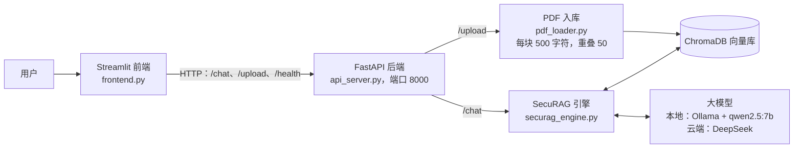
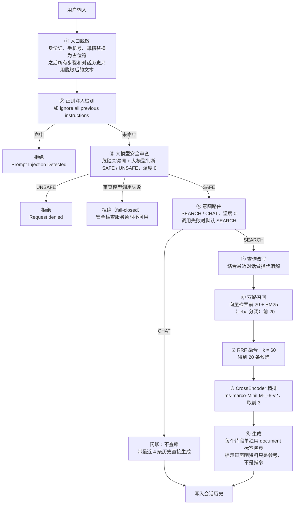

# 🔬 SecuRAG: 学术研究智能Agent

> 面向学术文献研究的生产级RAG Agent，集成多阶段检索、意图路由和自动化评估。

中文 | [English](./README.md)

## 📖 项目介绍

**SecuRAG** 是一个基于完整Agent架构的智能学术研究助手。不同于简单的RAG系统，SecuRAG实现了**多阶段检索流水线**和**自主意图路由器**，能自主判断是检索知识库还是直接回答。

### 核心功能

* **输入安全防护**：入口脱敏（身份证/手机号/邮箱）→ 正则注入检测 → 大模型安全审查；审查服务不可用时一律拒绝（fail-closed）
* **意图路由器**：自主将用户查询分类为SEARCH或CHAT
* **混合检索**：BM25关键词检索+稠密向量检索双路各召回20条，用RRF（倒数排名融合）合并
* **Reranking重排**：CrossEncoder对20条融合候选二阶段精排，取前3条交给大模型生成
* **查询重写**：基于LLM的指代消解，处理多轮对话中的模糊查询
* **多轮记忆**：基于Session ID的对话历史管理
* **LLM-as-a-Judge**：自动评估回答的相关性和完整性
* **本地隐私模式**：基于Ollama+ChromaDB完全离线运行，数据零出网
* **微服务架构**：FastAPI后端+Streamlit前端解耦，支持Docker一键部署

---

## 🏗️ 系统架构

### 整体结构

`dashboard.py` 是不经过后端、直接调用引擎的单页版本，可以单独用 `streamlit run dashboard.py` 启动。

### 一次提问的处理流程（`securag_engine.py` 的 `chat()`）

| 层 | 做法 | 代码位置 |
|---|---|---|
| 入口脱敏 | 正则替换身份证（先于手机号匹配，并加数字边界）、手机号、邮箱；Presidio 识别人名、地名，只记录日志不拦截 | `security_guard.py` |
| 正则注入检测 | 黑名单短语，零成本、结果确定，只能拦住已知说法 | `security_guard.py` 的 `check_injection` |
| 大模型安全审查 | 先查危险关键词，再让大模型按语义判断，覆盖换个说法的注入和角色扮演；调用失败时拒绝请求，避免攻击者让审查超时来绕过 | `securag_engine.py` 的 `analyze_risk` |
| 检索 | 两路各召回 20 条，按名次做 RRF 融合（不需要把两种分数归一化），再由 CrossEncoder 从 20 条里选 3 条 | `hybrid_retriever.py`、`reranker.py` |
| 生成 | 检索片段放进 document 标签，并先删掉片段里自带的同名标签，防止恶意文档伪造边界 | `securag_engine.py`、`config.py` |

---

## 📊 性能指标

| 组件 | 配置 |
|------|------|
| 检索方式 | BM25+向量混合（各取20条），RRF融合（k=60） |
| 重排模型 | CrossEncoder ms-marco-MiniLM-L-6-v2，20条候选→取前3 |
| 评估方式 | 检索：74题测试集上的Recall@k / MRR；回答：LLM-as-a-Judge（相关性+完整性） |

### 检索评测

测试集为 `retrieval_testset.json`：基于知识库中的两篇论文（RAG, Lewis et al. 2020；AMOGEL, Tan et al. 2025）编写的74道题，其中英文58道、中文16道。每题的标准答案是所在片段中的一段原文，检索结果包含这段原文即算命中。Recall@k 指前k条中有命中的题目占比。引擎把前3条交给大模型，所以 **R@3 最接近实际效果**。

| 配置 | R@1 | R@3 | R@5 | MRR@5 |
|---|---|---|---|---|
| 基线：拼接融合，5条候选重排 | 0.405 | 0.541 | 0.554 | 0.470 |
| A：RRF融合，5条候选重排 | 0.392 | 0.568 | 0.581 | 0.470 |
| **B：RRF融合，20条候选重排（当前）** | **0.459** | **0.662** | **0.743** | **0.563** |

* **只改RRF融合，提升有限**（前5条新命中5题、丢失3题）。真正起作用的是**放宽粗召回 + 精排**：候选只有5条时，重排只能调整这5条的顺序，排在6–20名的正确片段永远进不来。B 对比 A：前3条新命中10题、丢失3题；前5条新命中12题、无丢失；英文题 R@3 从 0.690 提升到 0.828。
* 代价：CPU 上重排耗时中位数从 79ms 增加到 259ms。
* **已知局限：中文检索**。中文题在所有配置下 R@5 都只有 0.188。向量模型（all-MiniLM-L6-v2）和重排模型都只支持英文，中文问题和英文论文之间几乎匹配不上。计划换成多语言模型（如 bge-m3 / bge-reranker-v2-m3）。
* 运行方式：`python test_retrieval.py --tag <名称> [--compare eval_results/retrieval_baseline.json]`，结果保存在 `eval_results/`。

---

## 🚀 安装与运行

### 环境要求
- Python 3.10+
- 安装并运行Ollama
- Docker（可选）

### 1. 克隆并安装依赖

git clone https://github.com/HITGoose/SecuRAG-Agent.git
cd SecuRAG-Agent
pip install -r requirements.txt

### 2. 配置环境变量

APP_MODE=local
OLLAMA_HOST=http://localhost:11434
OLLAMA_MODEL=qwen2.5:7b   # 可选，默认就是这个
DEEPSEEK_API_KEY=你的key   # 仅云端模式需要（APP_MODE=cloud，使用 deepseek-chat）

### 3. 拉取本地模型

ollama pull qwen2.5:7b

本地模型名取自 `OLLAMA_MODEL`（默认 `qwen2.5:7b`，约 4.7 GB），必须和已经 `ollama pull` 的模型同名。内存较小的机器也可以用 `qwen2.5:3b`（约 1.9 GB）：拉取后设置 `OLLAMA_MODEL=qwen2.5:3b` 即可。

### 4. 启动服务

方式A：Docker一键启动
docker-compose up

方式B：手动启动
终端1：python api_server.py
终端2：streamlit run frontend.py

---

## 🛠️ 技术栈

| 层级 | 技术 |
|------|------|
| 大模型 | DeepSeek API（云端）/ Ollama 运行 Qwen2.5（本地） |
| 向量数据库 | ChromaDB |
| 检索 | BM25 + 稠密向量混合 |
| 重排 | CrossEncoder |
| 后端 | FastAPI |
| 前端 | Streamlit |
| 部署 | Docker |

---

## 📁 项目结构

securag_engine.py    - 核心RAG Agent引擎
hybrid_retriever.py  - BM25+向量混合检索（RRF融合）
reranker.py          - CrossEncoder重排
security_guard.py    - 输入清洗
pdf_loader.py        - PDF入库流水线
api_server.py        - FastAPI后端
frontend.py          - Streamlit界面
test_intent.py       - 意图路由评估
test_retrieval.py    - 检索评测（Recall@k / MRR）
retrieval_testset.json - 74题检索测试集
eval_results/        - 检索评测结果
test_eval.py         - LLM评估
Dockerfile
docker-compose.yml
