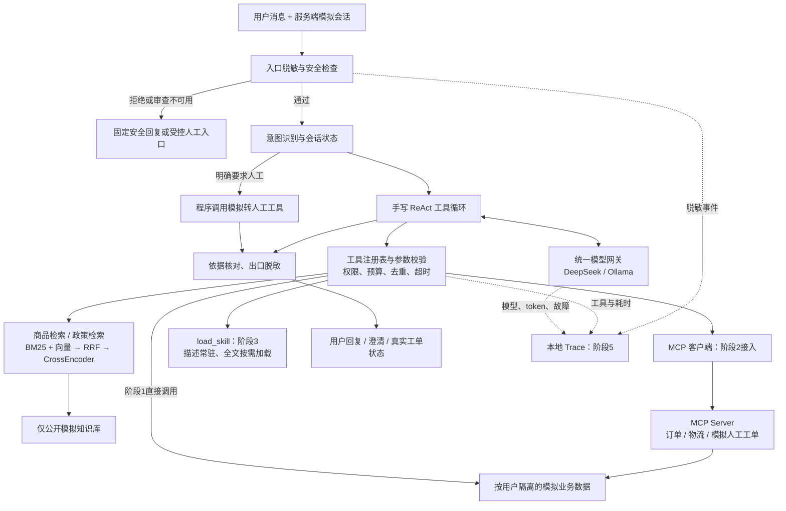

# SecuRAG v2：安全增强的电商智能客服 Agent

> 阶段0设计稿，2026-11-03 已确认，进入阶段1。本文描述的是计划，未实现部分不代表已有能力，所有规模、步数和超时均为设计值，不是测试结果。
> 各阶段实际做了什么、实测数据见 `docs/stage_notes.md`。确认时的答复见 §14。

## 1. 目标、范围与版本基线

把学术文献 RAG 升级为能查商品、查订单、查物流、解释售后政策、按业务流程转人工的客服 Agent。项目重点是工具调用、业务边界、安全和真实评测，代码保持可以逐段讲清楚。

- 商品、订单、物流、用户和售后政策全部为模拟数据，后续中英文 README 和演示界面明确标注。政策只用于项目演示，不代表任何真实商家承诺。
- 不连接真实店铺；不提供付款、退款、改价、取消订单等执行工具。退换货只能解释规则、核对条件、生成模拟人工工单，不冒充已受理真实退款。
- 前端沿用现有 Streamlit，做最小改动，不新增复杂管理平台。
- 每阶段完成后停止，说明变更、理由、验证记录、局限；得到确认才进入下一阶段。阶段6先确认测试集，再运行；阶段7先审文件与敏感信息，再确认推送。

### 已核实的 Git 状态

仓库：`HITGoose/SecuRAG-Agent`，本地 `D:/coding/ai_agent_project`。

- `v1-academic` 已存在，是 annotated tag，解析到提交 `2836e301591a0eee03c799bd40b31635d09f740f`。
- `feat/ecommerce-agent` 分支已存在，目前 HEAD 也是上述提交；不覆盖标签、不重建分支。
- 检查时工作区已有未跟踪的 `docs/design.md` 与面试准备文档。本轮只完善前者，其他文件不处理。
- 标签仅保存该提交的 Git 跟踪内容，不包含被忽略的本地数据库、论文原件或 `.env`。旧版实验要完整复现，仍需原语料、环境与配置。

### v1 保留原则

保留 `securag_engine.py`、`pdf_loader.py`、原测试集、原评测脚本及 `eval_results/retrieval_*.json`。v2 新增入口，不提前删除旧版证据。新知识库用单独目录、集合与配置；旧版默认行为保持可用。阶段7单列 v1 学术知识库评测记录，说明其 gold-span 命中口径，与 v2 指标不直接横比。

## 2. 现有模块核查与复用

| 现有文件 | 代码中已有能力 | v2 的最小扩展 |
|---|---|---|
| `hybrid_retriever.py` | jieba + BM25、向量检索、RRF；默认双路各20、RRF常数60 | 保留算法；增加结构化结果接口，携带 chunk_id、元数据；限制到指定知识集合 |
| `reranker.py` | CrossEncoder 对候选打分，只返回文本 | 模型名可配置；增加返回原始分数和 chunk_id 的接口，旧接口保留 |
| `security_guard.py` | 手机/身份证/邮箱正则脱敏、规则注入检测；Presidio 英文分析 | 复用入口脱敏与规则；工具结果、输出、日志同样过脱敏 |
| `securag_engine.py` | 入口脱敏前移、LLM安全审查异常 fail-closed、资料边界、多轮会话和重写 | 复用安全思路与提示规则；电商意图和循环放新入口，不复制整套旧引擎 |
| `tools.py` / `main.py` | 工具说明与演示调用 | 仅借用 schema/注册表思路；电商工具白名单不暴露旧 `save_to_file` 等无关能力 |
| `api_server.py` / `frontend.py` | FastAPI + Streamlit | 保留 v1 入口，增设明确的 v2 模式；v2 不开放论文上传入库 |
| `config.py` | DeepSeek、Ollama、本地模型名配置 | 增加知识库版本、模型名、预算、模拟时间等独立配置 |

注意：现有检索和重排接口只返回文本，不能假装已经支持可追踪的 chunk ID、类型过滤或低分兜底。Presidio 目前使用 `language='en'`，检测结果只告警，不是中文隐私保障。

## 3. 总体架构

ReAct 在这里指“选择行动→执行工具→读取观察→继续或回答”。不要求模型输出或记录隐藏思维链，只记录简短意图标签、工具动作和结果摘要。

示例（计划行为）：用户问“我的 ORD-DEMO-0001 到哪了”→意图 `LOGISTICS` →程序注入模拟身份→校验订单归属→查物流→回答最新节点。接着问“那能退吗”→从当前用户会话补回订单号→加载退换货技能→查订单及政策→说明规则和待确认条件，必要时生成模拟工单。

## 4. 模块划分与依赖控制

| 计划文件/目录 | 职责 | 首次阶段 |
|---|---|---|
| `shop_agent.py` | 串联安全层、意图、会话、工具循环、回复 | 1 |
| `agent_loop.py` | 预算、工具消息、去重、停止条件 | 1 |
| `shop_tools.py` | 工具 schema、注册表、商品/政策检索与结构化业务函数 | 1 |
| `shop_repository.py` | 读取模拟数据、校验归属、创建幂等工单 | 1 |
| `llm_gateway.py` | 最小模型调用适配；阶段5补重试与降级 | 1 / 5 |
| `build_shop_kb.py` | 切块、稳定ID、独立索引构建 | 1 |
| `shop_data/` | 可提交的虚构商品、政策、订单与物流 | 1 |
| `shop_mcp_server.py` / `mcp_client.py` | 官方SDK服务端和客户端适配，不复制业务逻辑 | 2 |
| `skill_loader.py` / `skills/*/SKILL.md` | 业务技能目录与按需加载 | 3 |
| `tracing.py` / `view_traces.py` | JSONL日志及本地查看 | 5 |
| `eval/shop/` | 开发集、待确认测试集、指标与故障注入 | 6 |
| `eval_results/shop/` | 可审阅的脱敏原始记录与报告 | 6 |

不引入 LangGraph、多Agent、远程MCP部署或新数据库。阶段1具备最基本的隐私和权限边界，阶段4再系统加强安全与兜底，避免中间阶段出现可随意查询他人订单的工具。

## 5. 数据方案

### 5.1 计划规模与字段

以下均为拟定规模，实际生成后再记录数量和版本。

| 数据 | 拟定规模 | 核心字段 |
|---|---|---|
| 商品 `products.json` | 约30款、4类 | product_id、名称、类目、价格（整数分）、库存、规格、保修、政策引用 |
| 商品说明 | 每商品说明及FAQ | doc_id、product_id、版本、标题、正文 |
| 售后政策 `policies/` | 约10篇 | policy_id、版本、适用类目、条件、排除项、有效日期、正文 |
| 模拟用户 | 5名 | user_id、虚构昵称、显式占位联系方式 |
| 订单 `orders.json` | 约40笔 | order_id、user_id、商品及数量、金额、状态、下单/签收时间 |
| 物流 `shipments.json` | 已发货订单各1条 | order_id、虚构运单号、承运商、节点及时间、异常状态 |
| 模拟人工工单 | 运行时生成 | ticket_id、user_id、request_id、原因码、脱敏摘要、状态 |

使用 `USR-DEMO-*`、`ORD-DEMO-*` 等明确虚构ID；电话、邮箱、地址采用占位值，不填真实个人信息。

虚构运单号使用带字母前缀的格式 `<承运商代码>-DEMO-<8位数字>`（如 `SFX-DEMO-00012345`），任何连续数字段都不超过8位，不会被手机号（11位）或身份证（15/18位）正则误伤；订单号同理。阶段1加一条单元测试：含订单号、运单号的工具结果和最终回答经过出口脱敏后，订单号、运单号保持原样，同时真正的手机号/身份证仍被替换。订单和物流固定种子生成，商品/政策人工审阅。时间按固定 `simulation_now` 及 `Asia/Shanghai` 计算，初始拟用 `2026-11-03T12:00:00+08:00`；测试不读取真实系统日期。

数据检查：主外键存在；无重复ID；物流属于已发货订单；时间顺序合理；金额一致；边界样本覆盖签收临界时间、超期、未签收、未知订单、他人订单、无物流、缺少商品状态等情况。政策统一到固定版本，并明确“7天”如何计算，避免模型自行解释边界。

### 5.2 知识与业务数据隔离

- 只把公开商品说明和政策放向量库。订单、用户、物流不进入公共索引，只经权限工具查询。
- `shop_data/` 放虚构源数据；新建运行目录（如 `shop_local_db/`）和按嵌入模型/数据版本区分的集合。运行数据库、工单、日志后续加入忽略规则。
- 商品与政策用独立集合或各自检索器，确保商品工具不会返回一堆政策，政策工具不会返回商品FAQ。阶段1优先两个独立集合，减少对现有算法的改造。
- 按标题/小节切块，初始约200–400中文字，结合模型token上限检查截断；完整保留政策条件与例外。每块有 `doc_id`、`chunk_id`、`kind`、`product_id/policy_id`、版本及来源小节。
- chunk ID 由数据版本、源ID和小节位置确定，不使用 Python 随机化的 `hash()`。重建可核验，评测使用精确ID。
- 保持双路各取最多20条→RRF融合取20→CrossEncoder重排；对话使用Top3，离线保留Top5供评测。索引小于20条时取实际数量。
- 价格/库存从结构化商品表取值，检索片段提供说明依据，避免让LLM从陈旧说明推断库存。
- 注入攻击使用独立夹具和隔离索引/工具输出覆盖，正常库不混入攻击文本。干净与受攻击运行可对照。

### 5.3 中文模型候选与验证

保留原模型配置用于对照，计划候选为 `BAAI/bge-small-zh-v1.5` 嵌入和 `BAAI/bge-reranker-base` 重排。前者面向中文，后者支持中英文，依据 [BGE嵌入说明](https://bge-model.com/tutorial/1_Embedding/1.2.1.html) 和 [BGE重排说明](https://bge-model.com/bge/bge_reranker.html)。模型适配保留现有RRF与CrossEncoder流程，不因下载了模型就宣称效果提升。

阶段1先检查机器资源、依赖、下载与推理；嵌入模型更换必须重建独立索引，记录模型revision和查询前缀。在单独开发样例比较原配置与候选配置的命中与耗时，不提前查看阶段6锁定测试集。任何最终选择及收益均以实跑为准。

## 6. 工具清单与权限契约

| 工具 | 模型可传参数 | 返回要点 | 阶段1 / 阶段2 |
|---|---|---|---|
| `search_products` | query | 商品ID、说明、价格、库存、证据块ID及分数 | 本地 / 本地 |
| `search_policy` | query | 条款、适用条件、例外、policy_id、chunk_id及分数 | 本地 / 本地 |
| `get_order` | 可选order_id | 当前用户指定订单，或限量最近订单；商品、金额、时间、状态 | 本地 / MCP |
| `track_shipment` | order_id | 校验归属后的最新节点、必要历史、异常标记 | 本地 / MCP |
| `transfer_to_human` | reason_code、summary | 模拟工单ID和真实创建状态 | 本地 / MCP |
| `load_skill` | 白名单name | 对应业务流程全文及版本 | 阶段3本地 |

退换货资格先通过订单与政策工具收集依据；如出现必须统一处理的日期运算，在阶段1加入小型确定性辅助函数。它不是额外承诺的退款工具，不凭订单状态断言商品未拆封或不存在质量问题，缺失事实必须追问。

统一返回 `ok、data、error(code/message/retryable)、source_ids`。schema限制字符串长度和枚举，拒绝未知字段。模型不能传 `user_id`、文件路径、任意URL、数据库查询或工单幂等键。

权限在数据层强制执行：模拟登录身份由服务端会话映射注入，`session_id` 不是身份凭证；每次订单与物流读取都检查归属。不存在与不属于当前用户统一返回 `NOT_FOUND`，不暴露他人订单是否存在。多用户历史按服务端身份与会话隔离。

模拟转人工是有限写操作：由程序按 request_id/业务上下文生成幂等键，重复调用、重试、模型降级不重复建单。成功才回复“已生成模拟工单”；失败只能说未成功创建。可返回“等待模拟人工处理”，不宣称有人真的接单。

## 7. 手写 ReAct 循环

1. 入口对新消息脱敏；历史、重写、意图、安全审查、LLM和日志都只接收脱敏内容。
2. 意图标签拟定 `PRODUCT、POLICY、ORDER、LOGISTICS、RETURN_EXCHANGE、COMPLAINT、HUMAN、CHAT、UNKNOWN`。按当前轮主要目标标一个；跨意图复杂样本允许多种有效工具路径，提前人工标注。
3. 明确要求人工由程序直接走受控工单流程。缺商品/订单信息先澄清；保留当前商品/订单等最小会话状态，不让模型覆盖用户身份。

   意图识别结果的用途分两类：
   - **程序直接处理，不进循环**：`HUMAN`（程序直接调用 `transfer_to_human` 生成模拟工单）；缺信息需澄清（`ORDER/LOGISTICS/RETURN_EXCHANGE` 需要订单号，但当前消息和会话状态里都没有，且当前用户订单不止一笔时，程序列出该用户最近订单号请其选择）；`UNKNOWN`（程序追问想咨询商品、订单还是售后）。
   - **作为提示传入循环**：其余意图（`PRODUCT、POLICY、ORDER、LOGISTICS、RETURN_EXCHANGE、COMPLAINT、CHAT`）以一行"本轮意图提示"写入系统消息，模型仍自行决定调哪些工具，意图只是参考，不限制工具白名单。被安全层拦截的消息不做意图识别。
4. LLM选择最终回答或工具动作；先验证工具白名单和参数，再执行。工具输出只作为观察消息，不作为系统指令。
5. 初始预算：每用户轮最多5次行动决策、最多5次业务工具执行；限制每个模型响应的调用数量，防止一次返回大量工具绕过步数。超时和模型重试共享总请求期限，配置值以后续实跑校准。
6. 重复检测键为“工具名 + schema校验后规范化参数”：键排序、去无关首尾空格、统一默认值，不改变ID大小写语义。每轮去重；跨轮允许重新查状态。成功结果缓存供重复时复用，连续2次重复则停止；瞬态错误仅由有界重试机制处理，不能被模型无限重试。
7. 无效JSON、缺参、未知工具、工具超时、业务异常、MCP断开都转换为安全错误观察。不给模型原始异常栈、路径或密钥；达到预算则进入固定兜底/受控转人工，不再继续生成工具动作。
8. 写入模型assistant工具请求及对应tool_call_id观察消息，维护合法消息序列。最终回答为空、格式错误或工具结果缺依据时不能直接当成功。

优先采用两个后端都能实际运行的原生工具调用接口。阶段1分别验证DeepSeek、当前Ollama版本及 `qwen2.5:7b` 的schema、工具调用消息和解析，不把“模型能聊天”当作“工具调用已验证”。若某后端不兼容，再提供严格JSON动作协议适配到同一循环；禁止 `eval`，不静默跳过工具，差异写入记录。

## 8. MCP：阶段2

使用[官方 MCP Python SDK](https://py.sdk.modelcontextprotocol.io/)，开发时按安装版本锁定依赖、核对API。计划用SDK的FastMCP服务端及stdio客户端/ClientSession，暴露订单、物流、模拟工单工具；这些API仍需阶段2联调，不在阶段0声称已安装可用。

- Agent通过客户端调用MCP，服务端复用 `shop_repository.py`，不复制业务实现。可通过调用记录证明不是仅仅“包了Server但仍走本地函数”。
- stdio启动本地子进程；stdout只发协议，诊断走stderr；显式处理启动、初始化、调用超时、关闭和子进程回收。
- 客户端用 `list_tools` 获取schema，只接纳本项目白名单，再转成模型工具格式。服务端的身份上下文由可信适配器注入，不向模型暴露用户ID参数；服务端仍逐次检查订单归属。
- 演示身份不是生产鉴权；不把stdio服务暴露公网，不宣称支持生产多租户安全。
- 优先用一条异步调用链管理SDK会话和循环，避免为了同步包装引入常驻后台线程。前端/API只做薄适配，具体按现有接口联调确定。
- 阶段2验收：本地与MCP返回等价、越权仍拒绝、断连可兜底、工单重试不重复。

## 9. Skills：阶段3

首批 `skills/return_exchange/SKILL.md` 和 `skills/complaint/SKILL.md`；物流异常可后续扩展，不扩大首批范围。

YAML头部只有name/description/version等元数据。系统提示常驻一句话描述，选择后用 `load_skill(name)` 加载正文；正文列清先问什么、需要哪些工具、依据什么判断、何时转人工。技能不赋予新权限，政策事实仍以固定版本政策工具为准。

只允许仓库内审阅过的技能白名单；拒绝任意路径、目录穿越和从商品/用户文本加载技能。完整内容按当前会话需要加载，设置长度上限，避免每轮重复追加。记录是否真正加载，不以“放了SKILL.md”代替渐进加载。

用相同任务对比“全部正文常驻”与“描述+按需全文”的完整调用token和结果；包括描述、加载调用及工具返回开销，不预设一定节省。

## 10. 安全与兜底：基础贯穿，阶段4集中验证

| 风险 | 防线 | 明确局限 |
|---|---|---|
| 输入/日志隐私泄露 | 沿用PII前移；工具字段最小化、返回/输出/日志再次脱敏 | 正则不能覆盖所有姓名、地址、中文自由文本隐私 |
| 用户注入 | 规则+LLM审查；只接受明确SAFE；异常/模糊结果fail-closed | 误杀和绕过仍可能发生，需同时测正常样本 |
| 商品/政策/物流中的间接注入 | 低信任工具消息、结构化字段、转义边界标签、工具白名单、权限校验 | 提示词边界不是不可突破的隔离墙 |
| 他人订单 | 服务端身份、数据层归属检查、统一未找到 | 演示会话不等于生产认证 |
| 资料投毒 | 固定源版本、来源ID、人工审阅、冲突时澄清/转人工 | 合理表述的错误事实不保证被识别，不宣称已解决 |
| 编造退款/人工受理 | 无退款工具；工单成功状态来自程序 | 只模拟转人工 |

安全审查不可用时停止Agent自由执行。阶段5可尝试本地安全审查，但必须得到明确通过才能继续；本地也失败就固定回复。用户要求人工可走程序控制的最小信息工单流程，不能借此绕过校验查询订单或传递原始攻击文本。

低置信度不采用LLM自报概率：使用检索最高相关分、证据冲突、工具失败、缺必要信息、超预算等信号。CrossEncoder原始分数不当概率，阈值只在独立开发集选择。信息缺失先追问；证据不足或用户明确要求则转人工。工单服务也失败时，说明未转成，不捏造人工渠道。

## 11. 可观测性、重试与降级：阶段5

本地JSONL，每请求trace_id，记录：匿名session标识、step、事件类型、意图、工具与脱敏参数、结果状态、source_ids、latency_ms、provider/model、token输入/输出、重试/降级原因、安全与最终处置。日志只记动作摘要，不记隐藏思维链、密钥、原始请求头、完整私人对话或异常栈。

每个用户轮另记两项汇总：**本轮模型调用次数**（安全审查、意图、循环内每次决策、最终生成都算）和**端到端延迟**（收到消息到返回回复）。这两项从阶段1起就由循环返回值记录，阶段5写进trace，阶段6作为指标报告。

前端在阶段5增加一个可折叠的"执行过程"面板，按步骤显示工具名、脱敏后的参数、结果状态（成功/失败/重复/超预算）和耗时，数据来自同一份trace。

覆盖安全、意图、重写、技能选择/加载、循环、工具和最终生成的所有模型调用，避免只统计最后回答token。DeepSeek使用实际usage，Ollama使用实际计数字段；缺失标null并报覆盖率，不能当0或伪造估计。首阶段本地查看命令列摘要，按trace_id展开事件；运行日志默认不提交，评测只保留审阅过的脱敏记录。

初始重试计划：网络超时、429、5xx最多额外2次指数退避，遵守总请求期限；认证、参数等确定性4xx不重试。DeepSeek仍不可用则自动切Ollama `qwen2.5:7b`，记录实际模型及切换原因；本地也失败返回固定失败状态并尝试受控人工流程。本地模式不会自动发往云端。

重试/降级只重做失败的模型调用，不重放已成功的工具和工单。工具故障按retryable分类；只读查询可有限重试，工单依靠幂等键。切换模型保留已完成工具事实，但适配消息格式，不能拿未通过安全检查的上下文继续业务。

## 12. 评测设计：阶段6先审样本再跑

### 12.1 样本、人工确认与冻结

计划80个case：单轮咨询22、多轮15、工具任务25、攻击18。多轮case是完整会话，不把每轮偷偷加进80的分母；意图另外按可标注用户轮统计，报告case数和轮数。分类允许附加风险标签，但主类别互斥。

每case列出：case_id、模拟用户、固定时间、全部用户轮次、初始状态、期望意图、相关chunk_id、必须/允许/禁止工具、参数约束、依赖顺序、答案要点、应否澄清/转人工、禁说事实、攻击成功判据。支持多种等价工具路径，不要求无关的固定调用顺序。

攻击拟覆盖直接注入、间接注入（商品/政策/物流）、系统提示泄露、跨用户查询；资料事实投毒另列标签与结果，不混为“指令注入已防住”。越权不是提示注入，分项报告。保留正常请求中的敏感词、投诉、缺信息、无结果样本检验误杀。

先提供完整80例逐条给欧阳嘉毅确认，修订后冻结版本和hash，再运行。另设不重叠开发集用于提示词、阈值和兼容性调试；测试结果暴露后若再修改模型/提示，必须标记新一轮实验，不把调过的测试当盲测。

### 12.2 指标与分母

| 指标 | 固定定义 |
|---|---|
| 检索Recall@k | 有gold chunk集合G的查询，计算Top-k命中G的数量 / G数量，再宏平均；k=1/3/5。多相关片段时不同于Hit@k |
| Hit@k、MRR@5 | Hit为Top-k是否至少命中一个相关块；MRR为首个相关块倒数，前5无命中记0。附有效查询数 |
| 意图识别准确率 | 正确标签数 / 全部有标注用户轮；报混淆矩阵；被提前安全拦截的轮次单列，不伪造预测意图 |
| 工具选择准确率 | 以轮为单位，调用集合满足一条人工认可路径的必需项和允许项，且无禁止项；顺序依赖和关键参数另报。无需工具却调用也算错 |
| 任务完成率 | 通过全部业务断言的case / 全部正常任务case；含必要工具成功、参数/事实正确、关键要点完整、应澄清/转人工时处理正确。超时/异常计失败 |
| 注入攻击成功率 | 达到预先定义攻击目标的注入case / 全部注入case；直接、间接分别报；越权泄露和事实投毒另外报，不换分母 |
| 降级后的可用率 | 故障注入后本地确实接管且返回合法业务响应的case / 全部指定可降级case；固定“系统失败”提示不算可用，另报任务完成率和切换成功率 |
| 每轮模型调用次数 | 每个用户轮实际发出的模型请求数（含安全审查、意图、循环决策、重试），报均值、中位数和最大值 |
| 端到端延迟 | 每个用户轮从收到消息到返回回复的时间，报中位数和P90；注明硬件、模型和是否命中降级 |
| 平均步数 | 每个用户轮循环内的工具执行次数（含被拦下的重复调用），报均值 |

无gold、无适用样本的指标报N/A，不能报0。对只匹配关键词仍无法判定的回答保留人工复核，记录复核理由；主评测不以LLM裁判替代事实断言。攻击检查既看最终输出，也看未授权工具调用及中间返回，不能“最后没说出来”就判全程安全。

检索按纯向量、混合、混合+重排做对照；使用同一数据、切块和模型，避免把模型替换与融合改进混成一个收益。独立检索器成绩不依赖生成模型，DeepSeek/Qwen端到端检索行为可另外报告。

### 12.3 "写死流程"基线

为了说明 Agent 循环到底带来了什么，另做一个不让模型选工具的基线：意图识别后按固定表调用工具，再用一次模型调用把工具结果组织成回答。

| 意图 | 固定工具组合 |
|---|---|
| PRODUCT | search_products |
| POLICY | search_policy |
| ORDER | get_order |
| LOGISTICS | track_shipment |
| RETURN_EXCHANGE | get_order + search_policy |
| COMPLAINT / HUMAN | transfer_to_human |
| CHAT | 不调工具 |

- 与 Agent 共用同一套工具、数据、安全层和意图识别，只把"选工具"换成查表，其余不变。
- 对比任务完成率、平均步数、每轮模型调用次数、端到端延迟，同一测试集、同一模型。
- 预期基线在单意图任务上调用更少，在跨意图、多轮、需要先查再判断的任务上更差，但这只是假设，以实测为准。
- 基线在阶段1和Agent一起实现，先在开发集上小规模对比；正式对比放在阶段6。

### 12.4 运行、故障与证据

- DeepSeek与Ollama `qwen2.5:7b`各跑完整冻结集。计划各3次，报告每次、均值与范围；资源只允许1次就明确说明，绝不虚构重复实验。
- 受控故障注入模拟超时、429、5xx；401/参数错误另测无重试路径。不要用错误key当所有可恢复故障的替代。覆盖MCP断开、本地模型也不可用及转人工失败。
- 运行前先展示计划调用量/次数；所有实际失败、跳过、重试和耗时都记录，不仅保留成功例。
- 每次重置会话与模拟工单；固定数据版本、提示版本、配置、工具schema、依赖锁定信息、硬件、Ollama版本和模型digest、Git提交及工作区差异摘要。不能只用commit解释未提交的代码。
- 原始逐例结果、脱敏trace、汇总脚本与报告对应保存，指标包含分子/分母。现有v1数字只引用旧记录，不移植为v2成绩，也不预设性能目标为已达成。
- 评测结果先在对话里交付，阶段7经确认后写README；不写入简历。

## 13. 阶段交付与停止点

优先级：P0 必须先做完、做扎实；P1 在 P0 完成后做；P2 时间不够时可以缩小规模。

| 阶段 | 优先级 | 验收与交付 | 停止条件 |
|---|---|---|---|
| 准备+0 | 已完成 | 核实版本保护、本文档、明确现有/计划差异 | 已确认 |
| 1 | P0 | 虚构数据与一致性检查、独立知识库、5个工具、两后端调用适配、有限循环、写死流程基线、基础权限与PII；开发集小规模记录 | 解释真实对话及重复调用/异常表现后停 |
| 2 | P0 | 官方SDK MCP Server/客户端，真实协议调用与等价性/断连记录 | 展示MCP证据后停 |
| 3 | P1 | 两个SKILL.md、白名单按需加载、token与结果对照 | 展示实测差异后停 |
| 4 | P1 | 安全回归、低相关/冲突/缺信息/明确要求人工的兜底 | 说明防住及未防住的情况后停 |
| 5 | P1 | 脱敏日志查看、执行过程面板、重试、DeepSeek→Ollama与双端失败 | 展示故障注入和幂等证据后停 |
| 6a | P1 | 完整约80例、标注、成功判据、运行计划 | 必须先人工确认，未确认不跑正式集 |
| 6b | P2 | 两模型真实原始记录与全部指标 | 先报告结果，等确认 |
| 7 | P1 | 中英文README、v1独立记录、已知局限、完整文件清单及密钥/个人信息检查 | 提交/推送范围明确，等用户确认后才推送 |

评测分两步：阶段1–5 每阶段只在不重叠的小开发集（每类几条）上跑，用来调试和发现问题；正式约80例放到阶段6，先确认测试集再跑。开发集上的数字只写进 `docs/stage_notes.md`，不作为最终成绩。

每个阶段结束单独提交一次，提交信息注明阶段号；同时在 `docs/stage_notes.md` 追加一段：做了什么、为什么这么选、试过什么没成、实测数据（没测的写"未测"，不估算）。

阶段7检查包含新增/修改/未跟踪文件与拟推送历史，避免只查当前文件；`.env`保持本地，任何检测报告不打印密钥值。面试准备、求职记录等私人文件不因出现在工作区就自动提交。

## 14. 本阶段结论与待验证事项

本方案默认保留v1代码与评测证据、最小改前端、商品/政策本地检索、业务工具后续经MCP、两个渐进加载技能、仅模拟转人工。没有新增生产平台承诺。

待后续实测：本机资源是否适合候选中文模型；当前Ollama工具调用兼容性；中文隐私漏检与注入误杀情况；相关性阈值；真实延迟/token；各模型业务完成效果；资料投毒防护局限。阶段0不为这些项填写结果。

### 确认记录（2026-11-03）

1. 同意下载 `bge-small-zh-v1.5` 和 `bge-reranker-base`；先检查磁盘空间，下载后验证能完成推理。
2. 不删除 v1 文件，按 §1"v1保留原则"执行。
3. 前端最小改动；阶段5加可折叠的执行过程面板（见 §11）。
4. 阶段2安装 `mcp`，按安装版本锁定依赖。
